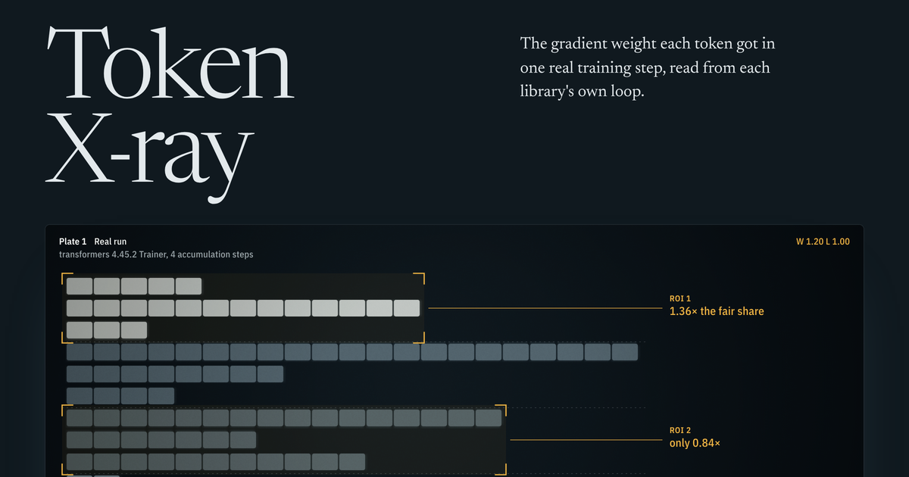

# Token X-ray

**See what your training stack actually does to every token.**

[](https://tokenxray.pages.dev/)

[](https://github.com/kaushikdhola/token-xray/actions/workflows/ci.yml)
[](https://github.com/kaushikdhola/token-xray/actions/workflows/xray.yml)
[](https://pypi.org/project/token-xray-ml/)
[](LICENSE)

A loss function is an equation, but the gradient each token receives is decided by the training loop:
how it batches, pads, packs, accumulates and splits work across devices. Token X-ray runs that loop, the
library's own, on a tracer model and reads back the weight every token actually got, then checks it
against what the equation says. It also measures whether gradient leaks from one document into another.

- **[Read the story](https://tokenxray.pages.dev/)**: radiographs of real training steps, one chapter per
  mechanism.
- **[Use the package](xray/README.md)**: `token_xray` checks your own training step in a few lines.

## What it found

| Setting                                                             | Result                                                                                        |
| ------------------------------------------------------------------- | --------------------------------------------------------------------------------------------- |
| transformers **4.45.2** `Trainer`, gradient accumulation (real run) | mean of micro-batch means: short sequences in small micro-batches count more (fixed Oct 2024) |
| Current `Trainer`, accumulation 1×8 vs 4×2, shuffled order          | token mean, invariant to how the batch is split                                               |
| Packed sequences, `position_ids` reset, default `use_cache`         | **documents leak into each other, silently** (known issue, transformers#50419)                |
| Data parallel, `average_tokens_across_devices=False`                | per-rank mean: tokens on the rank with fewer tokens count more                                |
| TRL GRPO (`dapo`, `grpo`, `dr_grpo`), DPO, SFT with packing         | match their equations, including the tokens the clip zeroes                                   |
| Left padding with labels = input ids                                | one extra target per sequence (a labelling convention, not a bug)                             |

Every row is a measurement through the library's own code unless it says otherwise; mechanisms that
cannot be run here are reproduced as clearly labelled emulations. The full list, with versions and what
each run changes from the defaults, is in [`xray/README.md`](xray/README.md#what-is-checked-today).

## How we know it is right

- **Closed forms.** Every check compares the measured weights with the weight the equation predicts
  (or, for leaks, with exactly zero), to the instrument's precision floor of about 2×10⁻⁷.
- **Mutation-tested.** [`scripts/mutate.py`](scripts/mutate.py) plants 52 faults one at a time, 44 in the
  instrument and 8 realistic bugs injected into transformers and TRL. Every fault is caught, and each of
  the 60 tests catches at least one.
- **Independent oracles.** The GRPO, DAPO and Dr. GRPO coefficients on the page are computed in
  TypeScript and held to a separate Python reference and to fixtures derived from the papers.
- **Red-teamed.** A separate review tried to break every claim; its report and the fixes are in [`docs/redteam/`](docs/redteam/).

## Quick start

```bash
pip install token-xray-ml
```

Check a Hugging Face `Trainer` or TRL `SFTTrainer` before you train it:

```python
from token_xray import xray_trainer

xray_trainer(trainer).assert_token_mean()   # replays one step of your setup on a tracer model
trainer.train()
```

Or X-ray a hand-written training step:

```python
import torch
import torch.nn.functional as F
from token_xray import xray

def my_step(model, sequences):
    # replace this body with your trainer's batching, forward and backward;
    # this one is a correct loop: every target token is divided by the same count N
    n = sum(len(s) - 1 for s in sequences)
    for s in sequences:
        ids = torch.tensor([s])
        logits = model(input_ids=ids).logits[0, :-1]
        (F.cross_entropy(logits, ids[0, 1:], reduction="sum") / n).backward()

report = xray(my_step, lengths=[5, 9, 3, 12, 7, 4, 10, 6])
report.assert_token_mean()   # every target token received weight 1/N
print(report.table())
```

To work on the site and the package (Node 20+, Python 3.10.2+, git):

```bash
bash scripts/setup.sh        # dependencies, the 4.45.2 side environment, and every test
npm run dev                  # the story at /, the atlas at /atlas/
node scripts/xray.mjs test   # the package's tests
```

## Also in this repository: Lineage

**[The Lineage atlas](https://tokenxray.pages.dev/atlas/)** is a family tree of AI math: watch the
equations behind modern AI evolve into each other, from the dot product to multi-head attention, from the
Bellman equation to DPO, from benchmark accuracy to pass^k. Moving to a child formula morphs the equation
term by term and names the step. Every formula is computed, not drawn: each one is backed by an
implementation tested against independent NumPy, SciPy and statsmodels references.

| Family      | Formulas | Highlights                                                    |
| ----------- | -------: | ------------------------------------------------------------- |
| Foundations |        4 | dot product, cosine similarity, softmax, temperature          |
| Attention   |        7 | Bahdanau → Luong → scaled dot-product → causal → multi-head   |
| Agents      |        8 | return → Bellman → Q-learning, REINFORCE → PPO → RLHF → DPO   |
| Evals       |        7 | accuracy, Wilson, McNemar, pass@k, pass^k, Bradley–Terry, Elo |

Planned: about 130 formulas across seven families.

## Commands

| Command                        | What it does                                                    |
| ------------------------------ | --------------------------------------------------------------- |
| `npm run dev`                  | Local development server                                        |
| `npm run ci`                   | Lint, format check, type check, verify and build (what CI runs) |
| `npm run verify`               | Regenerate oracle references, validate the atlas, run all tests |
| `npm run atlas:check`          | Atlas report: coverage, citations, structural validation        |
| `node scripts/xray.mjs test`   | The package's tests                                             |
| `node scripts/xray.mjs export` | Re-measure everything into `public/xray/data.json`              |

The share image, `public/og/story.png`, is rendered from the hero film with
`.venv/bin/python scripts/render_og.py http://localhost:5181` while `npm run dev` runs.

## Architecture

```
index.html   The Token X-ray story (home page); atlas/index.html is the atlas.
xray/        The token_xray package: tracer probe, readout, runners, closed forms, tests.
src/
  story/     The story's film renderer, controller and styles.
  core/      Numerical engine. Pure TypeScript, no DOM. The only place math happens.
  atlas/     Formula data (TeX, notation, citations), lineage edges, graph utilities, validation.
  math/      KaTeX rendering, token identity, the morph engine and the symbol bus.
  scene/     three.js scenes, driven by core and bound to the symbol bus.
  ui/        The atlas shell and live probes.
python/      Independent reference implementations → tests/fixtures/*.json
public/xray/ Measurements exported by the package; the story reads only these.
```

**Data flow:** the package measures → `public/xray/data.json` → the story draws it. Closed forms on the
page come from `src/core`, which is held to `python/`. Nothing on the page is typed in by hand.

## Contributing

See [CONTRIBUTING.md](CONTRIBUTING.md). Security reports: [SECURITY.md](SECURITY.md).

## License

Code: [MIT](LICENSE). The story's text, figures, films and measurements: [CC BY 4.0](LICENSE-CONTENT.md),
credit "Kaushik Dhola, Token X-ray". To cite the software, use GitHub's "Cite this repository"
([CITATION.cff](CITATION.cff)).
