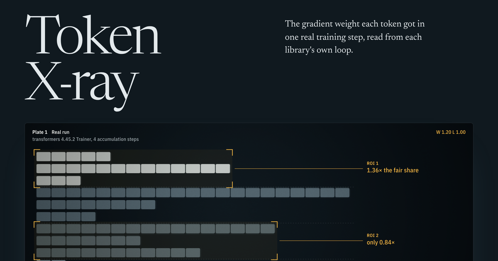

# Token X-ray

**Measure the gradient weight your training loop gives every token.**

[](https://lineage-ml.pages.dev/)

[The story](https://lineage-ml.pages.dev/) shows every measurement below as a radiograph of one training
step. Source and issues: [github.com/kaushikdhola/lineage-ml](https://github.com/kaushikdhola/lineage-ml).

Many silent training bugs, and several objective design choices, show up in one quantity: the gradient
weight each token receives. Others leak gradient from one sequence into another. Token X-ray measures
both by running your batching and loss code on a tracer model, and compares them with what the equation
says.

```python
import torch
import torch.nn.functional as F
from token_xray import xray

def my_step(model, sequences):
    # replace this body with your trainer's batching, forward and backward;
    # this one is a correct loop: every target token is divided by the same count N
    n = sum(len(s) - 1 for s in sequences)
    for s in sequences:
        ids = torch.tensor([s])
        logits = model(input_ids=ids).logits[0, :-1]
        (F.cross_entropy(logits, ids[0, 1:], reduction="sum") / n).backward()

report = xray(my_step, lengths=[5, 9, 3, 12, 7, 4, 10, 6])
report.assert_token_mean()   # every target token received weight 1/N
print(report.table())
```

## Install

```bash
pip install token-xray-ml            # add [trl] for the TRL scenarios
```

It imports as `token_xray` and installs the `token-xray` command (the name `tokenxray` is taken on PyPI).
Python 3.10.2 or newer. The latest unreleased code installs from the repository:
`pip install "git+https://github.com/kaushikdhola/lineage-ml#subdirectory=xray"`.

## How it works

A tiny LLaMA "probe" gives every token in the batch a unique id. In aggregation mode the attention
output is zeroed and frozen, so a position's loss depends only on its own embedding. The gradient the
stack produces at token _i_ is then `w_i · r_i`, where `r_i` is the token's unit-weight gradient
(computed on an identical probe), and the readout recovers:

- `w_i = ⟨g_i, r_i⟩ / ‖r_i‖²` — the weight the stack applied (×N, so a global token mean is 1.0)
- `cos(g_i, r_i)` — below 1 when the stack changed the gradient in a way that is not a rescaling

In leak mode attention is live. One backward per sequence, with only that sequence labelled; any
gradient reaching another sequence is a leak. On a correct stack it is exactly zero.

When one input token predicts several targets (the prompt's last token in preference and RL batches), the
weights are solved for by least squares on the targets' unit gradients; the condition number and the
unexplained remainder are reported, and the readout refuses systems it cannot identify (at most h − 1
targets per input for hidden size h). Under data parallelism the readout uses the embedding's parameter
gradient after the all-reduce. Gradient that reaches padding is collected, not dropped.

### What it cannot see

- **After backward.** The readout sees how the loss weights tokens, before gradient clipping and the
  optimizer. Bugs that live in the optimizer step, such as the DeepSpeed ZeRO-1/2 CPU-offload gradient copy
  emulated below, are outside its view.
- **Model state.** The probe is untrained, so its predictions are near-uniform. Anything that depends on
  the model's state (label smoothing's cosine, z-loss, DPO's margin, GRPO's ratios and clipping, the size
  of a leak) is measured for this probe, not for a trained model. The equations it checks hold either way.

### What each real run changes from the defaults

- the sample order is fixed with a sequential sampler (shuffled order is tested separately);
- gradient clipping is off (`max_grad_norm=0`) and bf16 is off (TRL's configs default to bf16);
- GRPO's completions are scripted: `model.generate` returns fixed tracer sequences, each ending with its
  own EOS id, and a fixed reward function scores them;
- the training step (or `compute_loss`) is wrapped only to record gradients and the batches seen.

## What is checked today

| Check                                                           | Runs                       | Result                                                                                                                                          |
| --------------------------------------------------------------- | -------------------------- | ----------------------------------------------------------------------------------------------------------------------------------------------- |
| Gradient accumulation 1×8 vs 4×2                                | real `Trainer`             | matches the token mean (≤ 2e-7)                                                                                                                 |
| Sample order (shuffled)                                         | real `Trainer`             | invariant                                                                                                                                       |
| Logged loss equals the objective                                | real `Trainer`             | equal                                                                                                                                           |
| Gradient accumulation, transformers **4.45.2**                  | real `Trainer` (side venv) | **mean of micro-batch means**, as fixed in Oct 2024; matches the closed form                                                                    |
| Left vs right padding                                           | real `Trainer`             | **differs**: with labels = input ids, the pad before each left-padded sequence predicts its first token, adding a target (labelling convention) |
| Label smoothing                                                 | real `Trainer`             | flagged: cosine < 1 (declared configuration; tiny on the untrained probe)                                                                       |
| pad = EOS with `DataCollatorForLanguageModeling`                | real collator              | EOS targets get zero weight                                                                                                                     |
| Mean of micro-batch means                                       | emulation                  | detected; matches closed form                                                                                                                   |
| Later micro-batches dropped                                     | emulation                  | detected; matches closed form                                                                                                                   |
| Data parallel, 2 ranks, `average_tokens_across_devices` default | real `Trainer`, torchrun   | token mean                                                                                                                                      |
| Data parallel, `average_tokens_across_devices=False`            | real `Trainer`, torchrun   | per-rank mean, matches closed form                                                                                                              |
| World size 1 vs 2, equal and uneven tokens per rank             | DDP (spawn, gloo)          | identical weights                                                                                                                               |
| `DistributedSampler` padding                                    | DDP (spawn, gloo)          | the repeated sample counts twice                                                                                                                |
| TRL SFT, `padding_free` and `packing` (bfd)                     | real `SFTTrainer`          | token mean; packed documents do not leak                                                                                                        |
| TRL DPO, sigmoid loss                                           | real `DPOTrainer`          | matches β·σ(−βΔ)/P per token                                                                                                                    |
| TRL GRPO, default (`dapo`), `grpo`, `dr_grpo`, two iterations   | real `GRPOTrainer`         | matches the clipped surrogate, including clipped tokens at 0                                                                                    |
| Padded rows                                                     | real model                 | no leak                                                                                                                                         |
| Packed, no boundaries                                           | real model                 | leaks (later documents into earlier)                                                                                                            |
| Packed, `position_ids` reset, `use_cache=False`                 | real model                 | no leak                                                                                                                                         |
| Packed, `position_ids` reset, default `use_cache`               | real model                 | **leaks**, no warning — known issue, see below                                                                                                  |

Versions: transformers 5.22.2, TRL 1.17.1, torch 2.15 (the 4.45.2 row uses torch 2.4.1).

**Emulations** reproduce, in plain PyTorch, the documented mechanism of a bug in code that cannot be run
here. They are always labelled and never presented as the library itself.

### Gradient accumulation before the October 2024 fix (the hero plate)

The site's first plate is a real run of the transformers **4.45.2** `Trainer` with four accumulation
steps, in a separate environment (`.venv-hf445`, pinned in `requirements-hf445.txt`, created by
`scripts/setup.sh`). `token-xray legacy-ga` runs the probe, the unit gradients and the readout entirely
inside that environment, so nothing mixes library versions. The weights match the mean of micro-batch
means in closed form; the current release matches the token mean.

### Data parallel: relation R2

R2: a token's weight must not depend on how the batch is split across data-parallel ranks. Activation
gradients are local to a rank (DDP averages _parameter_ gradients in the all-reduce), so these runs read
the input embedding's parameter gradient after the all-reduce. Tracer rows are unique, so row _t_ holds
token _t_'s gradient; on one process this row readout equals the activation readout.

- `torch.multiprocessing.spawn`, gloo, DDP around the probe: with a global token mean the weights for world
  size 1 and 2 are identical (equal and uneven tokens per rank); an average of per-rank token means breaks
  R2 whenever ranks hold different token counts, and matches `intended.per_rank_mean`.
- The real `Trainer` under `torchrun` on two CPU processes: the default
  `average_tokens_across_devices=True` gives the token mean; `False` gives the per-rank mean.
- **`DistributedSampler` padding.** With `drop_last=False` and a dataset that does not divide evenly, the
  sampler repeats samples. The repeat carries the same tracer ids, so its rows hold the sum of both copies,
  which is exactly what reaches the parameters: the repeated sample counts twice in that step
  (`intended.with_multiplicity`). This is documented sampler behaviour, not a bug.

### TRL runs

Real runs of `SFTTrainer`, `DPOTrainer` and `GRPOTrainer` (TRL 1.17.1) on the probe:

- **SFT** with `padding_free=True` and with `packing=True` (bfd): a global token mean across accumulation;
  the leak matrix built through the trainer (one run per document, labels on that document only) is
  exactly zero, because SFT passes `use_cache=False`.
- **DPO**, sigmoid loss: every completion token gets β·σ(−βΔ)/P, positive on chosen and negative on
  rejected answers (verified against autograd and measured through the trainer).
- **GRPO** with scripted completions (each ending with its own EOS id) and `num_iterations=2`: the default
  `loss_type` is `dapo`; `dapo`, `grpo` and `dr_grpo` all match the clipped surrogate at both steps,
  including the tokens the clip zeroes once ratios move. TRL's `dr_grpo` keeps `scale_rewards="group"`
  unless set to `"none"`; the published Dr. GRPO drops it. Step-1 weights are checked against
  [`src/core/aggregation.ts`](https://github.com/kaushikdhola/lineage-ml/blob/main/src/core/aggregation.ts).

### Known issue: packed sequences and `use_cache`

transformers detects packed sequences from `position_ids` only when no `attention_mask` is passed and no
cache object exists. Most model configs default to `use_cache=True`, which creates a cache even in
training mode, so a hand-written loop that feeds packed `position_ids` without `use_cache=False` attends
across documents silently. Loops with gradient checkpointing are unaffected (it turns the cache off), and
so is the `Trainer`, which sets `model.config.use_cache` from `TrainingArguments.use_cache`.

This is already reported in [transformers#50419](https://github.com/huggingface/transformers/issues/50419).
A maintainer first replied that a cache should not be used during training and suggested documenting
that requirement, then noted that `use_cache` defaults to true and linked the issue to a proposed fix.
Fixes are proposed in [#50190](https://github.com/huggingface/transformers/pull/50190) and
[#50421](https://github.com/huggingface/transformers/pull/50421). Until one lands, pass `use_cache=False`
when you train on packed sequences. Reproduction: [`repro/packed_position_ids_use_cache.py`](https://github.com/kaushikdhola/lineage-ml/blob/main/xray/repro/packed_position_ids_use_cache.py).

## Precision

LLaMA's RMSNorm and the HF loss compute in float32 inside a float64 model, so measured weights carry
up to ~2e-7 relative error. Tests use a tolerance of 1e-6. TRL's default bf16 mixed precision is tested
against bounds derived from bf16's unit roundoff u = 2⁻⁸: per token ≤ 2u, per sequence mean ≤ u (the mean
bound does not shrink with the number of targets, because the measured rounding errors within a sequence
are correlated). A 1% re-weighting exceeds it 2.6×, and a planted 1% normaliser fault fails the test. These
bounds replace a number that was first guessed and then raised after measuring; see
[`docs/DECISIONS.md`](https://github.com/kaushikdhola/lineage-ml/blob/main/docs/DECISIONS.md). The `eager` attention path in float64 produces NaN
on fully padded rows; the probe uses `sdpa`, the default.

## Development

```bash
pip install -e ".[dev]"
pytest
token-xray report
token-xray export ../public/xray/data.json   # needs ../.venv-hf445 for the 4.45.2 run (scripts/setup.sh)
node ../scripts/py.mjs ../scripts/mutate.py   # the mutation test, ~25 minutes
```

Every check is mutation-tested. [`scripts/mutate.py`](https://github.com/kaushikdhola/lineage-ml/blob/main/scripts/mutate.py) plants 43 faults, one at a time: 35 in the instrument itself (readout, recorder, probe, closed forms, leak harness, runners, data-parallel launchers) and 8 realistic bugs injected into transformers and TRL ([`xray/tests/conftest.py`](https://github.com/kaushikdhola/lineage-ml/blob/main/xray/tests/conftest.py)). Every fault is caught, and each of the 52 tests catches at least one. It runs in CI on pushes to `main` and nightly.

## License

MIT. See [LICENSE](https://github.com/kaushikdhola/lineage-ml/blob/main/LICENSE).
